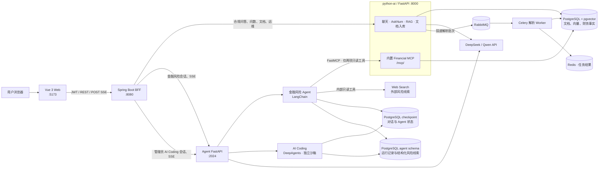

# RegOps Copilot

## 批量解析队列

解析任务使用 RabbitMQ 作为 Celery 消息代理、Redis 保存 Celery 任务结果，PostgreSQL 持久保存批次、逐文件阶段和折线图状态快照。批量上传或已有文档重解析通过 HTTP API 创建任务；监控页只查看与筛选任务，不提交批量解析。对话框上传同样交给解析 Worker。一个解析批次对应一个队列消息，每份文件有独立 `ingest_job`，失败文件不会阻止同批次后续文件。单文件同步 `/ingest?sync=true` 仍保留给脚本与测试。

已有 PostgreSQL 数据卷需先执行 `docs/sql/w13_ingest_batches.sql`，再启动新版本 API/Worker；新数据库由 Compose 初始化脚本自动建表。启动命令为 `docker compose up -d --build db rabbitmq redis python-ai ingest-worker java-service web`。监控使用 ECharts 显示批次状态、待处理/处理中/完成/失败文件数曲线、耗时、解析器与逐文件错误，并支持任务筛选。项目前端后续图表统一使用 ECharts。RabbitMQ 管理页为 `http://127.0.0.1:15672`（账号 `regops`，密码取 `RABBITMQ_PASSWORD`）。

解析 Worker 默认只从本地缓存加载 Embedding 模型，避免在任务中等待模型站点。首次部署须先将 `EMBEDDING_MODEL` 下载到 Worker 的 Hugging Face 缓存；本机开发启动 Worker 时可在 `python-ai/` 目录执行 `HF_HUB_OFFLINE=1 .venv/bin/celery -A app.ingest.tasks:celery_app worker --loglevel=INFO --pool=solo --concurrency=1 --queues=ingest`。未预置模型时任务会明确失败，不会无限停在向量化阶段。

> **基于公开披露数据构建的金融智能应用工程，不是任何金融机构的生产系统。**
> 全部业务数据来自上市公司公开年报与监管机构公开文件，不含客户数据或个人隐私信息；
> 模型输出一律附免责声明，不构成合规意见或投资建议。
> 详见 [`docs/DATA_SOURCES.md`](./docs/DATA_SOURCES.md)。

## 项目定位

RegOps Copilot 是一个面向金融合规与风险分析的大模型应用工程，包含两条业务主线：

- **合规问答**：在监管制度和上市公司年报中检索证据，回答必须带页码和原文引用。
- **金融风险审计助手**：Agent 自主查询财务事实、检索年报证据，输出待人工复核的风险线索，而不是自动作出审计结论。

项目把“可追溯、可拒答、可评测”作为硬约束：

- **答案必须带出处**：RAG 检索年报后作答，每条引用返回 `doc_id` + 页码 + 原文片段 + 可跳转链接，答不出就拒答，不猜。
- **数字必须经过质量门**：标准财务指标只读取已校验的 F10 结构化事实；缺来源、冲突或待复核数据不能进入确定性分析。
- **Agent 线索必须结构化**：每条风险线索包含严重程度、证据编号、数据点、不确定性和人工核查问题，并保存到 PostgreSQL。
- **评测必须可复跑**：自建黄金集 + 落盘报告，改了 Prompt 或检索参数后能立刻看出是否变差，
  而不是凭感觉。评测资产见 [`eval/`](./eval)。

## 架构与分工



详细的组件边界、金融 Agent 时序和数据归属见
[`docs/ARCHITECTURE.md`](./docs/ARCHITECTURE.md)。

| 服务 | 技术栈 | 负责 |
|------|--------|------|
| `python-ai` | FastAPI · Python 3.14 | LLM 调用、RAG 检索与引用、问数、文档解析入库、评测任务 |
| `java-service` | Spring Boot · JDK 21 | 对外 API 聚合、认证与 RBAC、审计 |
| `agent` | FastAPI · LangChain · DeepAgents | 风险初筛与 AI Coding 使用独立 API、会话命名空间和前端页面；AI Coding 仅在 OpenSandbox 中创建和修改代码，完成后导出 ZIP；见 [`financial-risk-audit-assistant/`](./financial-risk-audit-assistant/) |
| `web` | Vue 3 · Vite | 合规问答、金融风险审计助手、管理员 AI Coding、文档标注、评测与运维看板 |

服务边界、端点契约、`X-Request-ID` 关联 ID 约定见 [`docs/api-spec.md`](./docs/api-spec.md)。
W9-1 双栈链路与超时/降级见 [`docs/W9_E2E.md`](./docs/W9_E2E.md)。
红队 / Trace / Compose / K8s / 前端降级见 [`docs/W9_SECURITY.md`](./docs/W9_SECURITY.md) · [`docs/W9_OBS.md`](./docs/W9_OBS.md) · [`docs/W9_COMPOSE.md`](./docs/W9_COMPOSE.md) · [`docs/W9_K8S.md`](./docs/W9_K8S.md) · [`docs/W9_UX.md`](./docs/W9_UX.md)。

## 快速启动

首次准备（各一次即可）：

```bash
cp .env.example .env                                        # 填入 DEEPSEEK_API_KEY / QWEN_API_KEY
cd python-ai && python3 -m venv .venv && .venv/bin/pip install -r requirements.txt && cd ..
cd financial-risk-audit-assistant && python3.14 -m venv .venv && .venv/bin/pip install -r requirements.txt && .venv/bin/python scripts/sync_skills.py && cd ..
cd web && npm install && cd ..
```

默认 PDF 解析器是 Docling。如果需要切到 MinerU 4.x，再按需安装
`python-ai/requirements-mineru.txt`，并设置 `DOCUMENT_PARSER_BACKEND=mineru`。详见
[`python-ai/app/README.md`](./python-ai/app/README.md#pdf-解析器切换)。

一键启停全部服务：

```bash
./scripts/dev.sh up          # 启动全部；Docker 未开会自动拉起 Docker Desktop
./scripts/dev.sh status      # 端口 / PID / 健康 + 全链路连通性
./scripts/dev.sh stop        # 停止全部，db 数据保留在 volume db_data
```

若旧版独立 Agent 还占用 2024 端口，先手动停止旧实例；新脚本不会替你终止来源不明的进程。

| 服务 | 地址 |
| --- | --- |
| 前端 | <http://localhost:5173>（未登录先进入登录/注册页） |
| Java BFF | <http://localhost:8080/api/health> |
| python-ai Swagger | <http://localhost:8000/docs> |
| 金融风险审计助手 | <http://localhost:5173/risk-agent>（先登录） |
| Postgres + pgvector | localhost:5432 · regops/regops123 · regops_db |

脚本用法与注意事项见下方[「本地开发脚本」](#本地开发脚本)。

一键 Compose（web :8088，首次 python 镜像较慢）：

```bash
docker compose up --build
./scripts/compose-smoke.sh
```

Compose 会同时启动仅绑定本机 `127.0.0.1:8888` 的 SearXNG，供金融风险 Agent 检索外部公开线索；默认不需要第三方搜索 API Key。

合规问答的会话标题与消息保存在 PostgreSQL `chat_history`，按登录用户隔离；旧浏览器的本地记录首次登录后只导入一次，不覆盖已有服务端记录。已有数据库需先执行 `docs/sql/w11_chat_history.sql`。自助注册固定为投研分析师/投研部门，不能自行选择权限；生产部署还应增加邀请或审批与注册限流。

详见 [`docs/W9_COMPOSE.md`](./docs/W9_COMPOSE.md)。日常改代码仍用 `./scripts/dev.sh`。

最小 K8s（kind / minikube，需先 load 本地镜像）：

```bash
./scripts/kind-up.sh
# 或：kubectl apply --dry-run=client -k k8s/
```

详见 [`docs/W9_K8S.md`](./docs/W9_K8S.md)。前端降级行为见 [`docs/W9_UX.md`](./docs/W9_UX.md)。

## 试一下

```bash
# 1. 健康检查：应看到 java 与 python-ai 双层状态
curl -s http://localhost:8080/api/health

# 2. 查看已配置可用的模型（只返回配了 Key 的）
curl -s http://localhost:8000/models \
  -H 'X-Regops-Service-Token: dev-service-token'

# 3. 纯 LLM 对话（不检索）
curl -s -X POST http://localhost:8000/chat \
  -H 'X-Regops-Service-Token: dev-service-token' \
  -H 'Content-Type: application/json' \
  -d '{"message":"什么是审慎监管？一句话说明","use_rag":false}'

# 4. 年报问答（走 RAG，返回带页码的引用）
curl -s -X POST http://localhost:8000/chat \
  -H 'X-Regops-Service-Token: dev-service-token' \
  -H 'Content-Type: application/json' \
  -d '{"message":"比亚迪2024年营业收入是多少","use_rag":true}'

# 5. 跑一次合规结论 Schema 校验评测（不依赖 LLM，纯本地）
python-ai/.venv/bin/python eval/run_compliance_schema.py

# 5b. W6-3 数字校验黄金集（抽取终稿数字并回溯，不调 LLM）
python-ai/.venv/bin/python eval/run_w6_number_check.py

# 5d. W3-5 RAG 检索消融（baseline / hybrid / rerank；需入库年报）
python-ai/.venv/bin/python eval/run_rag_ablation.py

# 5d-1. 黄金集校验与重排候选数寻优
python-ai/.venv/bin/python eval/validate_rag_golden.py
python-ai/.venv/bin/python eval/run_rag_tuning.py

# 5e. W3-4 检索层部门 ACL / 无答案拒答（不调 LLM）
python-ai/.venv/bin/python eval/run_rag_acl.py --fail-on-regression
python-ai/.venv/bin/python eval/run_rag_refuse.py --fail-on-regression

# 6. W7 登录（详见 docs/W7_RBAC.md）
curl -s -X POST http://localhost:8080/api/auth/login \
  -H 'Content-Type: application/json' \
  -d '{"username":"analyst","password":"analyst123"}'

# 7. W9-1 健康、RAG 与问数冒烟（经 Java :8080；详见 docs/W9_E2E.md）
python-ai/.venv/bin/python eval/run_w9_e2e.py

# 8. 金融风险审计助手（先登录后在页面选择模型）
# 浏览器访问 http://localhost:5173/risk-agent

# 9. Agent 结构化结果、历史恢复和只读工具验证（不调用真实模型）
financial-risk-audit-assistant/.venv/bin/python financial-risk-audit-assistant/scripts/verify_risk_audit_result.py
financial-risk-audit-assistant/.venv/bin/python financial-risk-audit-assistant/scripts/verify_risk_agent_messages.py
financial-risk-audit-assistant/.venv/bin/python financial-risk-audit-assistant/scripts/verify_financial_audit.py

```

评测报告落在 `eval/reports/<任务>/<时间戳>/`，含 `report.json` 与 `report.md`。
基线与口径说明见 [`docs/eval_w1_baseline.md`](./docs/eval_w1_baseline.md)、
[`docs/eval_rag_retrieval.md`](./docs/eval_rag_retrieval.md)、
[`docs/eval_rag_ablation.md`](./docs/eval_rag_ablation.md)、
[`docs/eval_rag_tuning.md`](./docs/eval_rag_tuning.md)、
[`docs/eval_rag_guard.md`](./docs/eval_rag_guard.md)、
[`docs/W8_PROMPTS.md`](./docs/W8_PROMPTS.md)、
[`docs/dify-comparison.md`](./docs/dify-comparison.md)。

## 目录结构

```
regops-copilot/
├── java-service/                         # Java 后端服务 (Spring Boot, JDK21)
│   ├── src/main/java/com/wbq/java_service/
│   │   ├── controller/                   # 控制器层（REST API）
│   │   ├── service/                      # 业务逻辑层
│   │   ├── repository/                   # 数据访问层（JPA）
│   │   ├── entity/                       # 数据库实体类
│   │   ├── dto/                          # 数据传输对象
│   │   ├── config/                       # 配置类（CORS、拦截器等）
│   │   ├── exception/                    # 全局异常处理
│   │   ├── util/                         # 工具类
│   │   └── JavaServiceApplication.java   # Spring Boot 启动类
│   ├── src/main/resources/
│   │   ├── application.yml               # Spring Boot 配置文件
│   │   ├── schema.sql                    # 数据库结构初始化
│   │   └── data.sql                      # 数据库初始数据
│   ├── pom.xml                           # Maven 配置
│   └── Dockerfile                        # Java 服务 Dockerfile
│
├── python-ai/                            # Python AI 服务 (FastAPI + RAG + 问数)
│   ├── app/
│   │   ├── chat/                         # 统一聊天路由与 DTO
│   │   ├── asknum/                       # 受控问数与事实库查询
│   │   ├── rag/                          # 混合检索、精排、引用与数字校验
│   │   ├── documents/                    # 文档上传、元数据与查看地址
│   │   ├── ingest/                       # PDF 解析、切分、校验与入库
│   │   ├── sessions/                     # 会话和会话级 PDF
│   │   ├── labeling/                     # 数据标注
│   │   ├── quality/                      # 财务事实质量门
│   │   ├── models/                       # LangChain 模型调用与模型列表
│   │   ├── prompts/                      # Prompt 模板与版本管理
│   │   ├── eval/                         # 评测任务与指标
│   │   ├── ops/ · obs/                   # 运行监控与 LLM 可观测性
│   │   ├── db/ · storage/ · security/    # 公共基础设施
│   │   ├── router.py                     # 全部 HTTP 路由清单
│   │   ├── README.md                     # 模块说明与调用链路
│   │   └── main.py                       # FastAPI 启动入口
│   ├── requirements.txt                  # Python 依赖
│   └── Dockerfile                        # Python 服务 Dockerfile
│
├── financial-risk-audit-assistant/       # 金融风险审计 Agent 服务
│   ├── agent/api/                        # 会话、模型选项、POST SSE
│   ├── agent/mcp/                        # FastMCP 客户端与工具白名单
│   ├── agent/financial/                  # 引用编号、RiskFinding 结构化结果
│   ├── agent/core/                       # runtime、checkpoint、事件流、模型配置
│   ├── agent/store/                      # PostgreSQL 业务 Store（运行与风险线索）
│   ├── scripts/                          # 离线验证脚本
│   └── README.md                         # Agent 设计、边界和运行说明
│
├── eval/                                  # 评测资产（可复跑、版本固定）
│   ├── golden/                           # RAG、对话、问数与数字校验黄金集
│   ├── reports/                          # 回归报告（按任务 / 时间戳归档）
│   ├── prompt_ab/                        # Prompt A/B 实验脚本与结果
│   └── scripts/                          # 公开基准下载脚本（不提交原数据）
│
├── web/                                   # 前端 (Vue3 + Vite)
│   ├── src/
│   │   ├── components/                   # 聊天气泡、输入框和公共布局
│   │   ├── views/agent/                  # 金融风险审计助手页面
│   │   ├── views/ops/ · views/quality/   # 运维与质量看板
│   │   ├── router/                       # 页面路由
│   │   ├── api/                          # Java BFF API 与 SSE 客户端
│   │   ├── types/ · utils/               # DTO、引用渲染与工具函数
│   │   ├── App.vue                       # 根组件
│   │   └── main.ts                       # 前端入口
│   ├── index.html                        # 页面入口
│   ├── package.json                      # 前端依赖
│   ├── vite.config.js                    # Vite 配置
│   └── Dockerfile                        # Vue 前端 Dockerfile
│
├── docs/                                  # 文档目录
│   ├── api-spec.md                       # API 规范（Java + Python）
│   ├── ARCHITECTURE.md                   # 当前系统架构、Agent 时序和数据归属
│   ├── DATA_SOURCES.md                   # 公开数据源清单与使用边界声明
│   ├── BUG_NOTES.md                      # 坏例记录与已知限制（编号 + 归因层）
│   ├── W4_ASKNUM.md ~ W9_UX.md           # 各周专题：问数 / RBAC / Prompt / 交付
│   ├── benchmarks/                       # 公开基准选型卡（不提交原数据）
│   ├── security.md                       # 安全边界：SQL 只读、PII、注入红队
│   └── deployment.md                     # 部署文档（Compose、K8s、信创适配）
│
├── k8s/                                   # 最小 K8s 清单（kind / minikube 可跑）
├── scripts/
│   └── dev.sh                            # 本地一键启停（db + SearXNG + python-ai + risk-agent + java + web）
├── compose.yaml                           # Docker Compose 编排文件
├── .env.example                           # 环境变量示例
└── README.md                              # 项目说明文档
```

## 本地开发脚本

`scripts/dev.sh` 支持 `up / stop / restart / status / logs`：

```bash
./scripts/dev.sh logs java   # 跟踪日志（python | agent | java | web | db）
./scripts/dev.sh restart
./scripts/dev.sh up db python   # 也可只操作部分服务
```

说明：

- 前端 `/api/*` 经 Vite 代理打到 Java BFF，Java 再转发 python-ai，因此三者需同时在线。
- `python-ai` 使用 Uvicorn reload，`web` 使用 Vite HMR，Java 使用 Spring DevTools；`risk-agent` 修改 Python 代码后需执行 `./scripts/dev.sh restart agent`。
- `scripts/dev.sh` 会把根目录 `.env` 统一注入 Python 与 Java；修改环境变量后需用 `./scripts/dev.sh restart` 重启进程。
- `java-service` 用系统 `mvn` 的离线模式启动（`./mvnw` 需联网下载 Maven 发行包）。若依赖有变动需联网拉取，用 `MVN_OFFLINE=0 ./scripts/dev.sh up java`。
- 表结构由 `compose.yaml` 挂载的 `docs/sql/*.sql` 在容器首次初始化时建立；`ddl-auto: none`，Hibernate 不改表。
