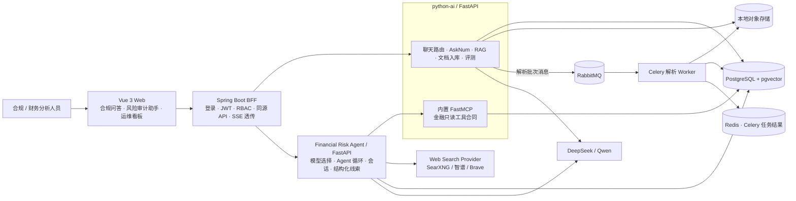
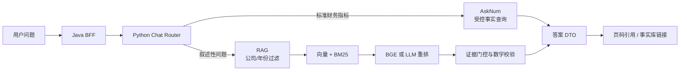
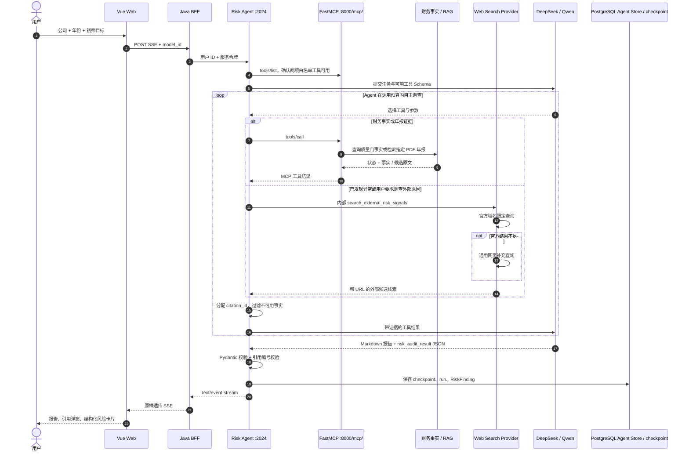
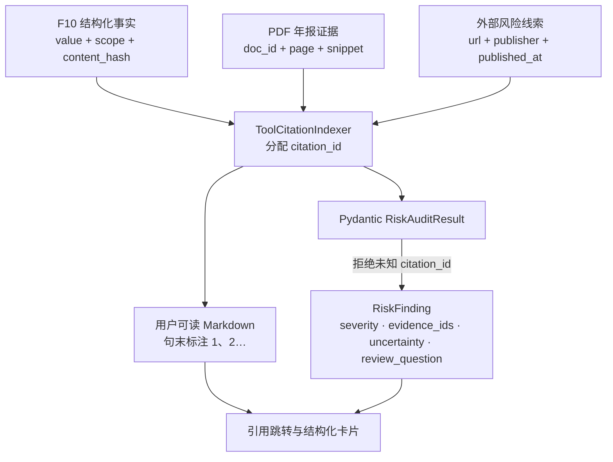

# RegOps Copilot 架构说明

> 本文只描述仓库中已经实现的架构。规划中的评测集和人工审核操作会单独标注，避免把目标设计写成现状。

## 1. 系统上下文

浏览器只访问 Java BFF。Java 从 JWT 中取得用户身份，再用服务令牌调用两个 Python 服务；浏览器不会拿到 Python 服务令牌、模型 API Key 或数据库凭据。

## 2. 服务职责

| 组件 | 主要职责 | 不负责 |
| --- | --- | --- |
| `web` | 页面、模型选择、POST SSE 消费、引用跳转、结构化风险卡片 | 不直连模型、MCP 或数据库 |
| `java-service` | 用户认证、RBAC、同源 API、错误映射、风险 Agent SSE 透传 | 不执行向量检索，不运行 Agent |
| `python-ai` | 文档解析入库、混合检索、重排、AskNum、财务事实质量门、FastMCP 服务 | 不保存风险 Agent 对话状态 |
| `ingest-worker` | 消费 RabbitMQ 解析批次；逐文件解析、清洗、分块、向量化并记录阶段快照 | 不响应用户 HTTP 请求 |
| RabbitMQ / Redis | 前者持久排队解析消息；后者保存 Celery 任务结果与状态 | 不作为财务事实或监控历史的权威库 |
| `risk-agent` | 金融初筛 Agent、工具选择、模型切换、引用编号、结构化结果、会话恢复；直连 PostgreSQL 保存状态 | 不写财务事实或年报原文 |
| PostgreSQL + pgvector | 文档、向量、财务事实、合规会话、Agent checkpoint 与业务 Store | 不替 Agent 判断风险 |

## 3. 两条主业务链路

### 解析任务链路

一次批量上传或重解析请求生成一个 `ingest_batch`，包含 1–50 个 `ingest_job`；API 提交数据库后投递一个 RabbitMQ 消息。Worker 从共享对象存储读取 PDF，逐份完成 Docling/MinerU 解析、清洗、分块、向量化，阶段更新和 `ingest_batch_event` 快照在 PostgreSQL 同一事务提交。监控页每 3 秒读取快照，按批次绘制待处理、处理中、完成、失败文件数的时间曲线。Redis 存 Celery 的执行结果，不替代 PostgreSQL 的持久监控历史。Worker 重取任务时跳过已完成或失败文件。

### 3.1 合规问答、问数与 RAG

- 标准财务指标优先走 AskNum，不从相似文本中猜数值。
- RAG 在检索前按文档、公司和年份过滤，再进行混合召回与可选重排。
- 证据不足、数字无法回溯或多公司口径不可比时拒绝直接下结论。

### 3.2 金融风险审计 Agent

金融 Agent 装配两个 MCP 工具和一个进程内只读搜索工具：

1. `lookup_financial_facts`：读取经过质量门、带 SHA-256 来源的 F10 结构化事实。
2. `search_report_evidence`：在指定公司、指定年份、已入库的 PDF 年报中检索带页码候选原文。
3. `search_external_risk_signals`：通过 Agent 内部 Web Search 查询监管、问询、诉讼、违约等外部公开线索，不经过 MCP。

外部搜索采用稳定的工具接口和可替换的 Provider：默认访问自建 SearXNG，失败时可按配置回退到智谱、Brave。检索先使用证监会、交易所、巨潮资讯等官方域名限定查询，结果不足才补通用检索；Provider 只产生候选结果，域名白名单、Prompt Injection 过滤、引用编号、哈希、缓存和限流仍由 Agent 工具层统一执行。

两项 MCP 工具不可用时会话创建直接返回 `503`；外部搜索未配置时只返回 `unavailable`，不阻断财务事实和年报初筛。`missing`、`unverified`、`conflict`、`missing_provenance`、`insufficient_evidence` 和 `unavailable` 都不能进入确定性风险结论。

## 4. 风险结果与证据链

F10 事实和 PDF 原文是两种不同来源：F10 使用内容哈希溯源，没有 PDF 页码；PDF 证据必须带真实页码。前端对 F10 引用跳转到事实库，对 PDF 引用跳转到文档查看页。

## 5. Agent 数据归属

| 数据 | 存储 | 用途 |
| --- | --- | --- |
| 完整 LangGraph messages、工具调用和图状态 | PostgreSQL `checkpoints` 等原生表 | 多轮上下文、刷新恢复 |
| thread、run、过程事件 | PostgreSQL `agent` schema | 会话列表、状态与排障 |
| `risk_audit_results`、`risk_audit_findings` | PostgreSQL `agent` schema | 结构化结果和后续人工审核 |
| 长期 StoreBackend 数据 | PostgreSQL LangGraph `store` 表 | 保留的通用 Harness 记忆能力；金融初筛不依赖它取事实 |
| 年报、chunk、向量、财务事实 | PostgreSQL + pgvector | RAG、AskNum、MCP 工具数据源 |

聊天正文以 checkpoint 为唯一权威来源。结构化风险结果通过回答哈希重新关联到对应历史回答，避免刷新后丢失；删除会话时同时清理业务 Store 与 checkpoint。

## 6. 安全与可靠性边界

- 浏览器不直连 Python；Java BFF 负责登录用户身份和同源入口。
- Java 到 Python 使用 `REGOPS_SERVICE_TOKEN`，并将用户 UUID 单独传递；Agent thread ID 带用户前缀，跨用户读取返回 `404`。
- 金融 Agent 使用工具白名单，不获得文件写入、Shell、Git 或 Gitee 能力。
- MCP 服务端工具声明只读，客户端再次按工具名过滤，新增工具不会自动获得权限。
- Agent 输出中的结构化 JSON 必须经过 Pydantic 和 citation ID 双重校验；校验失败只交付 Markdown，不伪造结构化记录。
- SSE 建立前的错误保留原始 HTTP 状态；流建立后的运行错误通过命名 SSE `error` 事件返回。

## 7. 当前完成度

已实现：

- RAG、AskNum、文档解析与引用跳转。
- Java 登录、RBAC、BFF 与审计基础设施。
- 金融 Agent 多模型选择、MCP 工具循环、会话隔离、checkpoint 和 SSE。
- F10 哈希来源、PDF 页码证据、引用编号与结构化 `RiskFinding` 持久化。
- 刷新恢复、服务重启恢复和失败关闭。

下一阶段：

- 建立 20～30 条金融风险黄金评测集。
- 增加结构化线索的人工接受、驳回和修改操作。
- 对比不同模型的召回率、误报率、引用正确率、耗时和成本。
