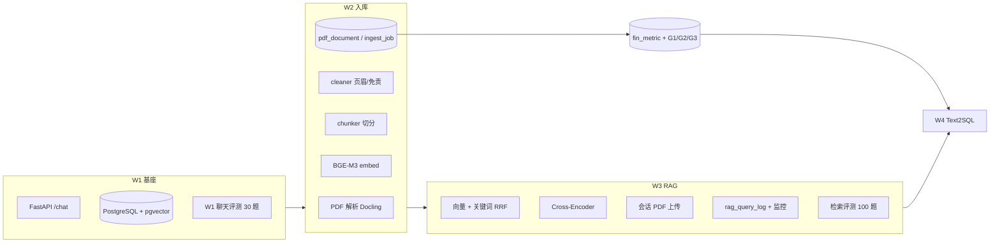

# W4 之前任务完成总览

> **RegOps Copilot** · 截至 2026-08-24  
> **范围**：第 1–3 周（W1 基座 · W2 RAG 入库 · W3 RAG 进阶）  
> **下一档**：W4 智能问数（第一刀已接：`/chat` 受控 lookup，见 [W4_ASKNUM.md](./W4_ASKNUM.md)）

---

## 1. Executive Summary

| 维度 | 结论 |
|------|------|
| **整体进度** | W1 **基本完成**；W2 **入库/RAG 主线 + F10 fin_metric 质量门完成**；W3 **检索管线可 demo，验收证据未齐** |
| **能否进 W4** | ✅ 可以。W4 依赖 `fin_metric` 结构化数字，与 W3 尾巴可并行 |
| **最强交付** | Hybrid RAG + 100 题检索评测 + 运维监控看板 + 会话 PDF 上传 |
| **最大缺口** | W3 ACL / 消融 / 外部对标；W4 Text2SQL 可开始 |

**Git 里程碑**（`main`，已推送）：

| 日期 | Commit | 内容 |
|------|--------|------|
| 2026-08-07 | `015216c` | Monorepo 骨架 |
| 2026-08-08 | `dfd2c6f` | W1：Python AI 基座 + pgvector |
| 2026-08-21 | `064621e` | W2/W3：RAG 合规问答、会话、Hybrid 检索 |
| 2026-08-21 | `425f020` | 运维：RAG 监控、评测报告、系统健康 |

**本地未提交变更**（2026-08-24）：黄金集修正、`retrieval.py` 关键词、`BUG_NOTES.md`、评测报告；草稿 `provenance.py` / `compare_rag_reports.py`（用户曾要求先不做 baseline 对比工具）。

---

## 2. 能力模块地图（W1–W3）

---

## 3. W1 · LLM 基座与服务（6 Must）

| 任务 | 计划交付 | 状态 | 证据 / 说明 |
|------|----------|------|-------------|
| **w1-1** ModelClient + 金融域选型 | DeepSeek/Qwen 封装 + 选型对照 | ✅ 完成 | `python-ai/app/models/`（deepseek、qwen、factory）；8 题实测对照 `docs/model_selection_w1.md`（DeepSeek 质量 4.5 / 延迟 4.7s，Qwen 3.8 / 12.5s，默认仍用 deepseek） |
| **w1-2** 结构化输出 / 合规 DTO | Pydantic Schema + 校验 | ✅ 完成 | `schemas/compliance.py`；20 样例黄金集 `eval/golden/compliance_schema_20.json`（10 合法 + 10 非法）+ runner `app/eval/compliance_schema_runner.py` + CLI `eval/run_compliance_schema.py`；首份报告 `eval/reports/compliance_schema/`（accuracy 100%、误放行率 0%）|
| **w1-3** FastAPI 骨架 + pytest | /health、/chat、/models | ✅ 完成 | `api/health.py`、`chat.py`、`models.py`；22 个 test 文件 |
| **w1-4** 自建基线 + 留出集 | 30 条黄金集 + eval 脚本 | ✅ 完成 | `eval/golden/w1_chat_30.json`（w1-v2，闭卷金融概念，关 RAG）、`eval/run_w1_chat.py`、`docs/eval_w1_baseline.md` |
| **w1-5** Monorepo + 数据合规 | DATA_SOURCES.md + README | ✅ 完成 | Monorepo ✅；`docs/DATA_SOURCES.md`（来源清单 + 使用边界 + 溯源方式）；`docs/api-spec.md`（W1 三端点契约 + X-Request-ID 约定 + 所有权图）；README 首屏改造（性质声明 → 问题 → 架构 → 启动 → 演示，示例命令均实测可跑）|
| **w1-6** 基准选型卡 ×5 | CFLUE/FinEval/FinanceBench 等 | ✅ 完成 | `docs/benchmarks/` 五张卡 + 索引（许可/污染/回归 vs 宣称）；`eval/scripts/download_*.sh` 只打印官方链接，原数据不进仓库 |

**W1 附加已完成**：

- 数据标注模块（`/quality/review`）：上传 Excel/JSON、PDF 对照标注
- 评测运维 UI：`/ops/eval` 一键跑 W1 聊天 / RAG 检索任务
- Java BFF：`java-service` 代理 Python AI（chat、documents、sessions、ops）

---

## 4. W2 · RAG 入库（6 Must + w2-6）

| 任务 | 计划交付 | 状态 | 证据 / 说明 |
|------|----------|------|-------------|
| **w2-1** 解析 + 噪声清单 | Docling 管线 + NOISE_PATTERNS.md | ⚠️ 大部分 | `ingest/parser.py`、`docs/NOISE_PATTERNS.md`；cleaner 已实现页眉/免责声明（BUG-007）；六类噪声多数仍「待填」；双栏合并/跨页表头 **未做** |
| **w2-2** 三表 + G1/G2/G3 | F10 JSON → fin_metric | ✅ 完成 | `financial.py` / `reconciliation.py` / `facts.py`；R01–R03；G1 冲突进 review；G3：PDF bbox 或 F10 `content_hash`；CLI `ingest_fin_metric.py`；看板 `/quality/gates` `/quality/facts` |
| **w2-3** 切分 + 条款元数据 | chunk + clause_no 等 | ⚠️ 部分 | `chunker.py` 可配置 size/overlap，metadata 含 page/doc_id/has_table；**无** clause_no、effective_date、dept_acl |
| **w2-4** PG 表结构 | document/chunk/fin_metric/ingest_job | ✅ 完成 | `docs/sql/w2_tables.sql`、`w3_chat_sessions.sql`；compose 自动 init |
| **w2-5** 幂等入库 + 状态机 | POST /ingest + ingest_job | ⚠️ 部分 | CLI `scripts/ingest_pdf_to_vectors.py` + 会话 `session_pipeline.py`（ingest_job）；**无** 批量 POST /ingest；批量 pipeline **不写** ingest_job 各阶段 |
| **w2-6** 基线 RAG + 30 条检索集 | Top-K + 引用 + 拒答 | ✅ 超额 | 被 W3 覆盖：100 题评测、Hybrid、引用页码、low_score 拒答 |

**W2 附加已完成**：

- 解析监控 UI：`/ops/ingest`（pdf_document、ingest_job、会话上传）
- 日志监控：`/ops/logs`（ingest 失败、RAG 异常 trace 聚合）
- parse 缓存：`ParseArtifactStore` + object store
- 文档查看器：citation → PDF 页跳转（`/documents/viewer`）

**W2 明确未做 / 占位**：

- PDF 表格抽取与 Docling bbox 交叉验证（G3 的 PDF 分支已有单测，未接年报表格解析）

---

## 5. W3 · RAG 进阶（5 Must）

| 任务 | 计划交付 | 状态 | 证据 / 说明 |
|------|----------|------|-------------|
| **w3-1** BM25 + Embedding 选型 | 稀疏检索 + FinMTEB 报告 | ⚠️ 部分 | BGE-M3 ✅；关键词路 `search_keyword_chunks`（ILIKE+词频，非真 BM25）；公司别名表 `company_scope.py` ✅；**无** FinMTEB 选型报告 |
| **w3-2** Hybrid + RRF | 向量+关键词融合 | ✅ 完成 | `rag/retrieval.py`、`rag/service.py`；单测 `test_rag_retrieval.py` |
| **w3-3** Reranker | Cross-Encoder + 对照报告 | ⚠️ 代码完成 | `bge-reranker-v2-m3` ✅，失败回退 RRF；**无** nDCG/延迟正式消融报告 |
| **w3-4** 引用 + 拒答 + ACL | dept_acl 过滤 + 20 条拒答集 | ⚠️ 部分 | 页码引用 + 角标 + PDF 跳转 ✅；寒暄 skip / low_score 拒答 ✅；公司/年份 scope ✅；**dept_acl 检索未接**；**无** 越权测试集 / 无答案 20 题集 |
| **w3-5** 评测 + 消融 + 对标 | 100 条 + baseline/hybrid/rerank 对比 | ⚠️ 部分 | `rag_retrieval_100.json` + UI 报告 ✅（Recall@k **82%**，MRR **0.53**，2026-08-21）；**无** 系统消融；**无** FinanceBench 对标；**无** nDCG |

**W3 附加已完成**：

- 会话级 PDF：`chat_session` / `session_document` + 后台 ingest
- RAG trace：`rag_query_log` + `/ops/rag` 监控（向量/关键词/RRF/精排链路）
- 系统健康：`/ops/health`（DB/pgvector/语料/配置概览）
- 公司 scope 过滤：问题含「比亚迪/002594/2024」时收窄 doc_id（BUG-008 已修）

**W3 检索质量已知问题**（见 `docs/BUG_NOTES.md`）：

- rag-027：车型列举 top-12 可中 p22，top-5 / MRR 仍不足
- rag-013：gold p5 在 top-12 rank 10
- 节标题 buried 在 chunk 末尾（BUG-011）影响 product_enum
- 当前 Recall@k = **题级 page_hit**（命中任一 gold 页即算），非经典 IR Recall

---

## 6. 前端与运维（跨周交付）

| 页面 | 路径 | 阶段 | 状态 |
|------|------|------|------|
| 合规问答 | `/` | W2–W3 | ✅ ChatPanel + RAG + 上传 PDF |
| 数据标注 | `/quality/review` | W1+ | ✅ |
| 质量门 | `/quality/gates` | W2-2 | ❌ 占位 |
| 财务事实库 | `/quality/facts` | W2-4 | ❌ 占位 |
| 解析监控 | `/ops/ingest` | W2-5 | ✅ |
| RAG 监控 | `/ops/rag` | W3 | ✅ |
| 日志监控 | `/ops/logs` | W2+ | ✅ |
| 系统健康 | `/ops/health` | W1 | ✅ |
| 评估报告 | `/ops/eval` | W1–W3 | ✅ |
| 文档查看 | `/documents/viewer` | W3 | ✅ |

---

## 7. 评测资产一览

| 任务 ID | 黄金集 | 指标 | 最近结果 |
|---------|--------|------|----------|
| `w1_chat` | `eval/golden/w1_chat_30.json`（30 题，w1-v2） | accuracy、refuse_rate、latency | 可跑（`use_rag=false`）；报告见 eval/reports/ |
| `rag_retrieval` | `eval/golden/rag_retrieval_100.json`（100 题，5 家年报） | recall_at_k、mrr | **82% / 0.53**（20260821_174606） |

**语料库**（RAG 评测覆盖）：

| doc_id | 公司 |
|--------|------|
| `002594_2024` | 比亚迪 |
| `601633_2024` | 长城汽车 |
| `000333_2024` | 美的集团 |
| `000651_2024` | 格力电器 |
| `600031_2024` | 三一重工 |

---

## 8. 代码与文档索引

| 目录 / 文件 | 职责 |
|-------------|------|
| `python-ai/app/ingest/` | parse → clean → chunk → embed → upsert |
| `python-ai/app/rag/` | Hybrid 检索、RRF、Rerank、引用、拒答、trace |
| `python-ai/app/eval/` | W1 聊天 / RAG 检索 runner |
| `python-ai/app/ops/` | 系统健康、ingest、logs 聚合 |
| `docs/NOISE_PATTERNS.md` | W2-1 噪声清单（待补样例） |
| `docs/INGEST_VALIDATION.md` | W2-2 三道质量门设计 |
| `docs/ACCOUNTING_RULES.md` | G2 勾稽规则索引（待实现） |
| `docs/eval_rag_retrieval.md` | 100 题检索集说明 |
| `docs/eval_w1_baseline.md` | W1 30 题说明 |
| `docs/BUG_NOTES.md` | 已知问题与回归记录 |

---

## 9. 缺口汇总（进 W4 前建议知晓）

### 9.1 阻塞 W4 Text2SQL 的项

| 项 | 说明 | 建议 |
|----|------|------|
| **fin_metric 已有 F10 原型** | 五家 2024 直读字段 + R01–R03 | W4 接 Schema / Text2SQL；PDF 交叉验证可后补 |
| **口径说明** | 合并报表、元、不手算比率 | 问数时带 `concept` / `scope` / `status=auto_accepted` |

### 9.2 不阻塞 W4、但影响「W2/W3 通关」的项

| 项 | 所属 |
|----|------|
| PDF 三表抽取 + Docling bbox 交叉验证 | W2-2 降级项（数字已走 F10） |
| dept_acl 检索过滤 + 越权测试 | W3-4（完整 RBAC 在 W7） |
| 消融报告（baseline / hybrid / rerank） | W3-5 |
| FinanceBench / FinMTEB 外部对标 | W3-1 / w3-3 / w3-5（选型卡已在 `docs/benchmarks/`，不必全量复跑） |
| NOISE 六类补样例 + 双栏合并 | W2-1 |
| POST /ingest 批量 API + ingest_job 状态机 | W2-5 |
| clause_no 元数据 + 按节切 chunk | W2-3 / RAG 质量 |

### 9.3 可复用的工作经验（未接入仓库）

腾讯 `pdf_handle` 清洗管线（版面块、跨页合并、序号连续性）→ 可抽 **10–20% 年报规则** 迁入 `cleaner.py`，不宜整包接入（预训练删引用 vs RAG 保引用）。

---

## 10. 进 W4 前的推荐优先级

若时间有限，按 **W4 依赖 + 面试证据** 排序：

1. **W4 Text2SQL**：查 `fin_metric`（status=auto_accepted）+ 口径说明
2. **W3 最小通关**：dept_acl 过滤雏形 + 10 条 badcase 归因文档（1 天）
3. **cleaner 增强**：双栏合并 / 节标题 chunk（可选，提升 RAG recall）
4. **W3-5 消融报告**（文档向，可 W4 并行）

---

## 11. 一句话状态（对外 / 面试）

> RegOps W1–W3 已完成 **金融 RAG 主链路**：5 份 A 股年报入库、Hybrid 检索（向量+关键词 RRF+Cross-Encoder）、会话 PDF 问答、100 题检索评测（Recall@12 **82%**）、全链路 trace 与运维看板。  
> **未完成**：PDF 表格交叉验证、部门 ACL 与系统消融报告。  
> **下一步 W4**：Schema 检索 + Text2SQL + 数字口径说明，查询 `fin_metric` 而非 PDF 抽表。  
> **2026-09-05**：第一刀已改为受控 lookup（`app/asknum/`），开放 Text2SQL 不做主路径。

---

*文档版本：w4-pre-v1 · 随里程碑更新 · 生成基准日 2026-08-24*
