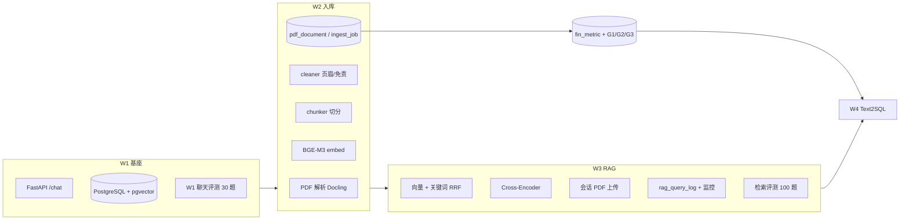

# W4 之前任务完成总览

> **RegOps Copilot** · 截至 2026-08-24  
> **范围**：第 1–3 周（W1 基座 · W2 RAG 入库 · W3 RAG 进阶）  
> **下一档**：W4 智能问数（第一刀已接：`/chat` 受控 lookup，见 [W4_ASKNUM.md](./W4_ASKNUM.md)）

---

## 1. Executive Summary

| 维度 | 结论 |
|------|------|
| **整体进度** | W1 **基本完成**；W2 **入库/RAG 主线 + F10 fin_metric 质量门完成**；W3 **检索管线可 demo，验收证据未齐** |
| **能否进 W4** | ✅ 可以。W4 依赖 `fin_metric` 结构化数字，与 W3 尾巴可并行 |
| **最强交付** | Hybrid RAG + 100 题检索评测 + 运维监控看板 + 会话 PDF 上传 |
| **最大缺口** | W3 ACL / 消融 / 外部对标；W4 Text2SQL 可开始 |

**Git 里程碑**（`main`，已推送）：

| 日期 | Commit | 内容 |
|------|--------|------|
| 2026-08-07 | `015216c` | Monorepo 骨架 |
| 2026-08-08 | `dfd2c6f` | W1：Python AI 基座 + pgvector |
| 2026-08-21 | `064621e` | W2/W3：RAG 合规问答、会话、Hybrid 检索 |
| 2026-08-21 | `425f020` | 运维：RAG 监控、评测报告、系统健康 |

**本地未提交变更**（2026-08-24）：黄金集修正、`retrieval.py` 关键词、`BUG_NOTES.md`、评测报告；草稿 `provenance.py` / `compare_rag_reports.py`（用户曾要求先不做 baseline 对比工具）。

---

## 2. 能力模块地图（W1–W3）

---

## 3. W1 · LLM 基座与服务（6 Must）

| 任务 | 计划交付 | 状态 | 证据 / 说明 |
|------|----------|------|-------------|
| **w1-1** ModelClient + 金融域选型 | DeepSeek/Qwen 封装 + 选型对照 | ✅ 完成 | `python-ai/app/models/`（deepseek、qwen、factory）；8 题实测对照 `docs/model_selection_w1.md`（DeepSeek 质量 4.5 / 延迟 4.7s，Qwen 3.8 / 12.5s，默认仍用 deepseek） |
| **w1-2** 结构化输出 / 合规 DTO | Pydantic Schema + 校验 | ✅ 完成 | `schemas/compliance.py`；20 样例黄金集 `eval/golden/compliance_schema_20.json`（10 合法 + 10 非法）+ runner `app/eval/compliance_schema_runner.py` + CLI `eval/run_compliance_schema.py`；首份报告 `eval/reports/compliance_schema/`（accuracy 100%、误放行率 0%）|
| **w1-3** FastAPI 骨架 + pytest | /health、/chat、/models | ✅ 完成 | `api/health.py`、`chat.py`、`models.py`；22 个 test 文件 |
| **w1-4** 自建基线 + 留出集 | 30 条黄金集 + eval 脚本 | ✅ 完成 | `eval/golden/w1_chat_30.json`（w1-v2，闭卷金融概念，关 RAG）、`eval/run_w1_chat.py`、`docs/eval_w1_baseline.md` |
| **w1-5** Monorepo + 数据合规 | DATA_SOURCES.md + README | ✅ 完成 | Monorepo ✅；`docs/DATA_SOURCES.md`（来源清单 + 使用边界 + 溯源方式）；`docs/api-spec.md`（W1 三端点契约 + X-Request-ID 约定 + 所有权图）；README 首屏改造（性质声明 → 问题 → 架构 → 启动 → 演示，示例命令均实测可跑）|
| **w1-6** 基准选型卡 ×5 | CFLUE/FinEval/FinanceBench 等 | ✅ 完成 | `docs/benchmarks/` 五张卡 + 索引（许可/污染/回归 vs 宣称）；`eval/scripts/download_*.sh` 只打印官方链接，原数据不进仓库 |

**W1 附加已完成**：

- 数据标注模块（`/quality/review`）：上传 Excel/JSON、PDF 对照标注
- 评测运维 UI：`/ops/eval` 一键跑 W1 聊天 / RAG 检索任务
- Java BFF：`java-service` 代理 Python AI（chat、documents、sessions、ops）

---

## 4. W2 · RAG 入库（6 Must + w2-6）

| 任务 | 计划交付 | 状态 | 证据 / 说明 |
|------|----------|------|-------------|
| **w2-1** 解析 + 噪声清单 | Docling 管线 + NOISE_PATTERNS.md | ✅ 完成 | `ingest/parser.py`、`docs/NOISE_PATTERNS.md` 六类均有样例；cleaner：页眉/免责/元信息/HTML/双栏硬换行/跨页表头（BUG-007）；完整双栏版面重建不做 |
| **w2-2** 三表 + G1/G2/G3 | F10 JSON → fin_metric | ✅ 完成 | `financial.py` / `reconciliation.py` / `facts.py`；R01–R04 见 `ACCOUNTING_RULES.md`；G1 冲突进 review；G3：PDF bbox 单测保留，年报数字走 F10 `content_hash`；CLI `ingest_fin_metric.py`；看板 `/quality/gates` `/quality/facts` |
| **w2-3** 切分 + 条款元数据 | chunk + clause_no 等 | ✅ 完成 | `chunker.py` 按节切 + 跨页标题下挂；metadata 含 `section_title`/`clause_no`/`effective_date`（仅完整年月日）；**dept_acl 在文档层不写 chunk**；原五家 + 宁德/茅台已 re-ingest |
| **w2-4** PG 表结构 | document/chunk/fin_metric/ingest_job | ✅ 完成 | `docs/sql/w2_tables.sql`、`w3_chat_sessions.sql`；compose 自动 init |
| **w2-5** 幂等入库 + 状态机 | POST /ingest + ingest_job | ✅ 完成 | CLI 与 `POST /ingest`（Java `/api/ops/ingest`）共用 `ingest_pdf_to_vectors`；阶段 PENDING→PARSING→CLEANING→CHUNKING→EMBEDDING→DONE/FAILED；`GET /ops/ingest/jobs/{job_id}` |
| **w2-6** 基线 RAG + 30 条检索集 | Top-K + 引用 + 拒答 | ✅ 超额 | 被 W3 覆盖：100 题评测、Hybrid、引用页码、low_score 拒答 |

**W2 附加已完成**：

- 解析监控 UI：`/ops/ingest`（pdf_document、ingest_job、会话上传）
- 日志监控：原 `/ops/logs` 聚合页已下线；解析与 RAG 状态分别在专用监控页查看，服务端日志保留。
- parse 缓存：`ParseArtifactStore` + object store
- 文档查看器：citation → PDF 页跳转（`/documents/viewer`）
- 批量 `POST /ingest` + ingest_job 全阶段

**W2 明确未做 / 占位**：

- PDF 表格抽取与 Docling bbox 交叉验证（G3 的 PDF 分支已有单测，**有意不接年报表格**；数字走巨潮 F10 JSON）

---

## 5. W3 · RAG 进阶（5 Must）

| 任务 | 计划交付 | 状态 | 证据 / 说明 |
|------|----------|------|-------------|
| **w3-1** BM25 + Embedding 选型 | 稀疏检索 + FinMTEB 报告 | ⚠️ 部分 | BGE-M3 ✅；关键词路 Okapi BM25（`app/rag/bm25.py`，问题短语 TF + IDF + 长度归一）✅；公司别名表 `company_scope.py` ✅；**无** FinMTEB 选型报告 |
| **w3-2** Hybrid + RRF | 向量+关键词融合 | ✅ 完成 | `rag/retrieval.py`、`rag/service.py`；单测 `test_rag_retrieval.py` |
| **w3-3** Reranker | Cross-Encoder + 对照报告 | ⚠️ 部分 | `bge-reranker-v2-m3` ✅，失败回退 RRF；消融含延迟 + nDCG@k，见 [`eval_rag_ablation.md`](./eval_rag_ablation.md)；**无** 真 BM25 |
| **w3-4** 引用 + 拒答 + ACL | dept_acl 过滤 + 20 条拒答集 | ✅ 完成 | 页码引用 + 角标 + PDF 跳转 ✅；寒暄 / 库外 / 缺年拒答 ✅；检索层 `dept_acl` + 越权 20 题，见 [`eval_rag_guard.md`](./eval_rag_guard.md) |
| **w3-5** 评测 + 消融 + 对标 | 100 条 + baseline/hybrid/rerank 对比 | ⚠️ 部分 | 100 题 + 三档 CLI + nDCG@k ✅；**无** FinanceBench 全量复跑（选型卡在 `docs/benchmarks/`） |

**W3 附加已完成**：

- 会话级 PDF：正文仍放临时对象路径，元数据统一写 `pdf_document`，切块统一写 `doc_chunks`；检索分池排序后仍先上传、再年报
- RAG trace：`rag_query_log` + `/ops/rag` 监控（向量/关键词/RRF/精排链路）
- 系统健康：`/ops/health`（DB/pgvector/语料/配置概览）
- 公司 scope 过滤：问题含「比亚迪/002594/2024」时收窄 doc_id（BUG-008 已修）

**W3 检索质量已知问题**（见 `docs/BUG_NOTES.md`）：

- rag-027：按节切 + 跨页标题下挂已入库；`rag_max_chunks_per_page=2` 同页最多留 2 条
- rag-013：问句已对齐第一节重要提示（gold p5）；第三节对照页 13/22/42 不另占 100 题
- 当前 Recall@k = **题级 page_hit**（命中任一 gold 页即算），另报 **nDCG@k** 与 **citation_accuracy**（top-k 去重页中 gold 页占比）

---

## 6. 前端与运维（跨周交付）

| 页面 | 路径 | 阶段 | 状态 |
|------|------|------|------|
| 合规问答 | `/` | W2–W3 | ✅ ChatPanel + RAG + 上传 PDF |
| 数据标注 | `/quality/review` | W1+ | ✅ |
| 质量门 | `/quality/gates` | W2-2 | ❌ 占位 |
| 财务事实库 | `/quality/facts` | W2-4 | ❌ 占位 |
| 解析监控 | `/ops/ingest` | W2-5 | ✅ |
| RAG 监控 | `/ops/rag` | W3 | ✅ |
| 日志监控 | `/ops/logs` | W2+ | 已下线 |
| 系统健康 | `/ops/health` | W1 | ✅ |
| 评估报告 | `/ops/eval` | W1–W3 | ✅ |
| 文档查看 | `/documents/viewer` | W3 | ✅ |

---

## 7. 评测资产一览

| 任务 ID | 黄金集 | 指标 | 最近结果 |
|---------|--------|------|----------|
| `w1_chat` | `eval/golden/w1_chat_30.json`（30 题，w1-v2） | accuracy、refuse_rate、latency | 可跑（`use_rag=false`）；报告见 eval/reports/ |
| `rag_support` | `eval/golden/rag_support_20.json`（20 题） | support_hit_rate、support_coverage | 与页级 Recall 分开，见 [`eval_rag_support.md`](./eval_rag_support.md) |
| `rag_acl` | `eval/golden/rag_acl_20.json` | accuracy、false_accept、leak | 脚本门禁 1.0 / 0 / 0 |
| `rag_refuse` | `eval/golden/rag_refuse_20.json` | accuracy、false_accept | 脚本门禁 1.0 / 0 |
| `rag_support` | `eval/golden/rag_support_20.json`（20 题） | support_hit_rate、support_coverage | **55% / 60%**（20260911_235731；与 79% 页命中分开） |

**语料库**（RAG 评测覆盖）：

| doc_id | 公司 |
|--------|------|
| `002594_2024` | 比亚迪 |
| `601633_2024` | 长城汽车 |
| `000333_2024` | 美的集团 |
| `000651_2024` | 格力电器 |
| `600031_2024` | 三一重工 |

---

## 8. 代码与文档索引

| 目录 / 文件 | 职责 |
|-------------|------|
| `python-ai/app/ingest/` | parse → clean → chunk → embed → upsert |
| `python-ai/app/rag/` | Hybrid 检索、RRF、Rerank、引用、拒答、trace |
| `python-ai/app/eval/` | W1 聊天 / RAG 检索 runner |
| `python-ai/app/ops/` | 系统健康、ingest、logs 聚合 |
| `docs/NOISE_PATTERNS.md` | W2-1 噪声清单（六类样例 + cleaner 规则） |
| `docs/INGEST_VALIDATION.md` | W2-2 三道质量门设计 |
| `docs/ACCOUNTING_RULES.md` | G2 勾稽规则索引（R01–R04 已实现） |
| `docs/eval_rag_retrieval.md` | 100 题检索集说明 |
| `docs/eval_rag_ablation.md` | baseline / hybrid / rerank 三档对照 |
| `docs/eval_rag_guard.md` | 部门 ACL + 无答案拒答 |
| `docs/eval_w6_number_check.md` | W6 数字校验归档报告 |
| `docs/eval_w1_baseline.md` | W1 30 题说明 |
| `docs/BUG_NOTES.md` | 已知问题与回归记录 |

---

## 9. 缺口汇总（进 W4 前建议知晓）

### 9.1 阻塞 W4 Text2SQL 的项

| 项 | 说明 | 建议 |
|----|------|------|
| **fin_metric 已有 F10 原型** | 五家 2024 直读字段 + R01–R04 | W4 接 Schema / Text2SQL；PDF 交叉验证可后补 |
| **口径说明** | 合并报表、元、不手算比率 | 问数时带 `concept` / `scope` / `status=auto_accepted` |

### 9.2 不阻塞 W4、但影响「W2/W3 通关」的项

| 项 | 所属 |
|----|------|
| PDF 三表抽取 + Docling bbox 交叉验证 | W2-2 有意降级（数字走 F10） |
| FinanceBench / FinMTEB 外部对标 | W3-1 / w3-3 / w3-5（选型卡已在 `docs/benchmarks/`，不必全量复跑） |

### 9.3 可复用的工作经验（未接入仓库）

腾讯 `pdf_handle` 清洗管线（版面块、跨页合并、序号连续性）→ 可抽 **10–20% 年报规则** 迁入 `cleaner.py`，不宜整包接入（预训练删引用 vs RAG 保引用）。

---

## 10. 进 W4 前的推荐优先级

若时间有限，按 **W4 依赖 + 验收证据** 排序：

1. **W4 Text2SQL**：查 `fin_metric`（status=auto_accepted）+ 口径说明
2. **W3 最小通关**：dept_acl 过滤雏形 + 10 条 badcase 归因文档（1 天）
3. ~~**cleaner / 按节切 / re-ingest**~~：噪声六类 + 节标题 chunk 已入库
4. ~~**W3-5 消融报告**~~：已有 [`eval_rag_ablation.md`](./eval_rag_ablation.md)（100 题三档 + 延迟）

---

## 11. 当前状态摘要

> RegOps W1–W3 已完成 **金融 RAG 主链路**：5 份 A 股年报入库、Hybrid 检索（向量+BM25 RRF+Cross-Encoder）、会话 PDF 问答、100 题检索评测（现网 Recall@12 **79%**、CiteAcc **15.5%**）与 baseline/hybrid/rerank 消融、全链路 trace 与运维看板。  
> **未完成（有意降级）**：年报 PDF 表格 bbox 交叉验证、FinanceBench 全量复跑。  
> **下一步 W4**：Schema 检索 + Text2SQL + 数字口径说明，查询 `fin_metric` 而非 PDF 抽表。  
> **2026-09-05**：第一刀已改为受控 lookup（`app/asknum/`），开放 Text2SQL 不做主路径。

---

*文档版本：w4-pre-v1 · 随里程碑更新 · 生成基准日 2026-08-24*
