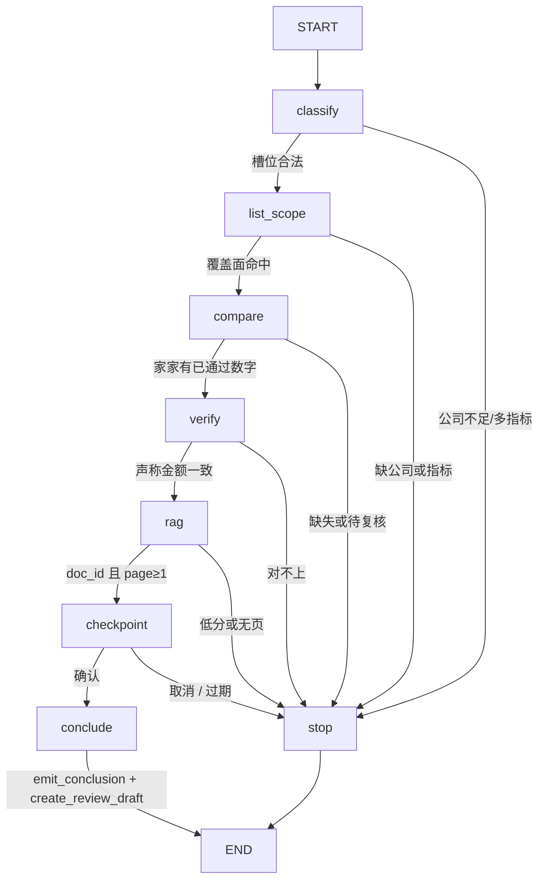

# W6 审查对比工作流

> 这是 **Workflow**（显式状态机），不是 ReAct Agent。模型不选边。W6-1～W6-6 已齐：固定 DAG、Checkpoint、数字校验、PENDING 工单、预算停机、20 条轨迹评测。

## 何时进图

`/chat` 且 `use_rag=true` 时：

| 问题 | 路由 |
|---|---|
| 比亚迪 2024 营收多少 | 问数（0 token） |
| 对比比亚迪和长城 2024 营收 | 问数，并列查数 |
| 对比两家净利润，并结合管理层讨论给出结论 | **本图**（结论前 Checkpoint 暂停） |
| 确认 / 取消 | 同一 `thread_id` 续跑或废弃检查点 |
| 格力 2024 经营得怎么样 / 研发投入 / 营收能不能用 | **工具自选**（模型选只读工具） |
| 你自己选工具：… | 同上 |
| `use_rag=false` | 不进图 / 不进工具循环（W1 闭卷评测） |

用户面仍是 `/`，没有独立 Agent 页。

## 图（DAG，无回边）



`interrupt_before=["conclude"]`：查数、核对、检索已经落进 SQLite Checkpoint。暂停回复带【待写入草稿预览】（结论、条款、影响范围）。人确认后只跑 `emit_conclusion` + `create_review_draft`，不重跑前面的工具。取消删除检查点，不建草稿。

工具仍是 W5 合同：`list_scope` → `compare_peers` → `verify_number` → `rag_search` → `emit_conclusion` → `create_review_draft`。不手算差额，不执行 SQL。写工具只落 `PENDING`，不提交 maker-checker。

同输入 + 同工具响应 → 同一条轨迹。`recursion_limit` 取 `workflow_max_steps`（默认 12）。`thread_id` 形如 `{dept}:{uuid}`。同一 `thread_id` 再确认不会建第二条草稿。

## Checkpoint 不是 Memory

| | Checkpoint | Memory |
|---|---|---|
| 存什么 | 当前任务节点、已查数字、年报引用 | 跨轮偏好 / 闲聊事实 |
| 用来干什么 | 暂停、进程中断后恢复、避免重复写 | 让下一句「它」能指代上一句 |
| 本仓库 | `data/checkpoints/review.sqlite`，默认 24h 过期 | **不做**。RAG / 问数仍是单轮 |

跨部门：续跑时 `X-Regops-Dept` 必须和 `thread_id` 前缀一致，否则拒绝且不读状态。登录鉴权在 Java（见 [`W7_RBAC.md`](./W7_RBAC.md)）；Python 图里的部门前缀仍是租户键。

## 工具自选（Function Calling）

下列情况**不走本图**，改走 `app/agents/tool_loop.py`：模型用 W5 Schema 自己选只读工具，最多 4 轮。数字仍只认工具返回。

| 原因 | 例子 |
|---|---|
| 点名 | 「你自己选工具…」 |
| 经营概况（有公司、无标准指标） | 格力 2024 年经营得怎么样 |
| 库外科目 | 研发投入、毛利率、ROE、分红政策 |
| 待复核/缺失追问 | 美的营收到底能不能用 |

两家+结论仍优先本图；单问「营收多少」仍优先问数。风险因素等叙述仍走 RAG。

硬预算（w6-5）：审查图默认最多 8 次工具、12 步、120s；工具自选默认 4 轮、6 次工具、1 次 `lookup_metric`、8000 Token。超时/越权/缺数分类后停止，写工具失败不盲重试。超预算回复必须带「预算」并声明未写入工单。

## 数字校验（w6-3）

终稿不靠 Prompt 保证不编造。`app/agents/evidence.py` 在工具自选、审查图暂停/结论、RAG 成稿之后：

1. **抽取**：金额（元/万/亿）和百分数；跳过年份、页码、`[n]`、证券代码、小时/家数。
2. **回溯**：对回工具 `value_yuan` 或引用片段里的数。
3. **拦截**：对不上 → 前缀 `【数字校验拦截】`，原文数字换成 `〔无证据〕`。量纲错误（万元 vs 亿元、0.1091 vs 10.91%）和手算差额/比率分开记账，不混进「数字错误率」。
4. **评测**：`eval/golden/w6_number_check_20.json`，20 例本地跑，误放行必须为 0。FinQA / TAT-QA 只说明失败形态，不入库官方题、不写准确率宣称。工单 `draft_id`（UUID）不当金额。

`verify_number` 仍是「一个声称金额 vs 一条 fin_metric」；本节点扫的是整段终稿。

## 人工确认与审查工单（w6-4）

审查对比**不会**在查数阶段写库。流程是：

1. **抽取**：图跑完 `rag` 后暂停，回复里给出将要写入的标题、影响范围、条款引用、结论全文。
2. **确认**：用户回复「确认」。编排层才调用 `emit_conclusion`（Schema 校验）和 `create_review_draft`（Postgres `review_draft`，`status` 只能是 `PENDING`）。
3. **可见**：Java `GET /api/tools/review-drafts` 按部门列出；跨部门按 `public_id` 取会 404。Java 这一步只是看见草稿，不是批准。
4. **幂等**：`thread_id` 唯一。图节点重入或第二次「确认」（检查点已结束）都不会插第二条。
5. **取消**：删除检查点，不调用写工具。

`backend=mock` 仍拒绝写。工具自选白名单不含 `create_review_draft`。提交 / 复核由 Java 做，状态是 `SUBMITTED → REVIEWED | REJECTED`，没有 `APPROVED`。见 [`W7_RBAC.md`](./W7_RBAC.md)。

## 预算、重试与降级（w6-5）

`app/agents/budget.py` 用 ContextVar 把限额套进图和工具循环：

| 限额 | 图 | 工具自选 |
|---|---|---|
| 步数 / 轮次 | `workflow_max_steps`（也是 LangGraph `recursion_limit`） | `tool_loop_max_rounds` |
| 工具次数 | `workflow_max_tool_calls`（默认 8，覆盖查数+核对+检索+结论+草稿） | `tool_loop_max_tool_calls`（默认 6）+ `lookup_metric` 1 次 |
| 时间 | `workflow_max_time_ms` | `tool_loop_max_time_ms` |
| Token | 图几乎 0 token | `tool_loop_max_tokens` |

超时 → 「转人工」；越权/缺数 → 停止不插值；超预算 → 明确终止且不写工单。恢复同一 `thread_id` 不重跑查数、不建第二条草稿。

## 轨迹评测（w6-6）

`eval/golden/w6_workflow_20.json` 覆盖正常、模糊、越权、注入、诱导编造、工具失败、预算、HITL。Runner 脚本工具，不调 LLM、不看文笔。

```bash
python-ai/.venv/bin/python eval/run_w6_workflow.py --fail-on-regression
```

指标：`accuracy`、`param_accuracy`、`avg_steps`、`confirmation_rate`；失败记到节点。

## 不做什么

- 不把每轮 `/chat` 丢进图或工具循环
- 不提交 maker-checker、不把草稿改为 REVIEWED（那是 W7 Java）
- 不把对话历史写入 Checkpoint
- 不上开放 ReAct（W8 对照实验）
