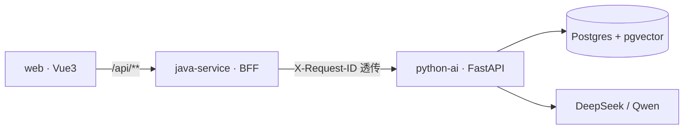

# API 契约与服务边界（w1-5）

本文档描述 RegOps Copilot 的服务边界、W1 核心端点契约、关联 ID 约定与错误格式。

- **python-ai**（FastAPI，`:8000`）：AI 能力本体。交互式文档 <http://localhost:8000/docs>，
  机器可读契约 <http://localhost:8000/openapi.json>（`title: RegOps Copilot AI Service`，`version: 0.1.0`）。
- **java-service**（Spring Boot，`:8080`）：BFF / 网关，对外统一 `/api/**` 前缀，转发 python-ai。
- **web**（Vite，`:5173`）：前端，`/api/*` 经 Vite 代理打到 java-service。

> 本文档为手写契约，端点清单以运行中的 `openapi.json` 为准；两者不一致时以代码为准并更新本文。

---

## 1. 所有权划分

调用链：`浏览器 → web(:5173) → java-service(:8080) → python-ai(:8000) → Postgres/pgvector`



| 关注点 | Owner | 说明 |
|--------|-------|------|
| LLM 调用与模型选路 | **python-ai** | `app/models/llm.py`：统一的 LangChain 模型客户端 |
| RAG 检索、重排、引用、拒答 | **python-ai** | `app/rag/` |
| 文档解析与入库 | **python-ai** | `app/ingest/`、`app/documents/` |
| 评测任务与报告 | **python-ai** | `app/eval/` |
| 问数（受控 lookup） | **python-ai** | `app/asknum/` 接入 `/chat`，只查询已核验的财务事实 |
| 认证、RBAC、部门数据权限 | **java-service** | JWT + `@PreAuthorize`；问答/评测仍可不登录，见 [`W7_RBAC.md`](./W7_RBAC.md) |
| 审计留痕 | **java-service** | 记录受保护的业务操作 |
| 对外 API 聚合与错误归一 | **java-service** | `controller/*ProxyController` + `GlobalExceptionHandler` |
| 页面与交互 | **web** | Vue3 + vue-router |

**边界原则**：python-ai 不做权限判断，只做 AI 能力；java-service 不做模型推理，
只做鉴权、聚合、审计。跨服务调用一律带 `X-Request-ID` 以便串联日志。

---

## 2. W1 核心端点契约

### 2.1 `GET /health`

存活探针，无参数。

**响应 200**

```json
{ "status": "ok", "service": "regops-python-ai" }
```

BFF 侧 `GET /api/health` 会附带下游状态（下游异常时不影响本级返回 200）：

```json
{
  "status": "ok",
  "service": "java-service",
  "pythonAi": { "status": "ok", "service": "regops-python-ai" }
}
```

> 注意：`/api/health` 即使 python-ai 不可用也返回 **200**，此时 `pythonAi.status` 为 `"down"`
> 并带 `error` 字段。做健康判断必须看响应体，不能只看状态码。
> 容器编排请用 java-service 的 `GET /actuator/health`。

### 2.2 `POST /chat`

**请求 `ChatRequest`**

| 字段 | 类型 | 必填 | 约束 / 默认 | 说明 |
|------|------|------|-------------|------|
| `message` | string | ✅ | 1–16000 字符 | 用户问题 |
| `temperature` | number | | 0.0–2.0，默认 `0.1` | 采样温度 |
| `session_id` | string \| null | | 须为合法 UUID | 会话 ID，用于关联本会话上传的临时文档 |
| `use_rag` | boolean | | 默认 `true` | 关掉则纯 LLM 对话，不检索 |
| `model` | string \| null | | 默认取 `DEFAULT_MODEL` | 须在 `GET /models` 返回的可用列表内 |

**响应 200 `ChatResponse`**

| 字段 | 类型 | 说明 |
|------|------|------|
| `reply` | string | 模型回答 |
| `model` | string | 实际使用的模型 |
| `disclaimer` | string | 默认「本回答由 AI 生成，仅供参考，不构成合规或投资建议。」 |
| `citations` | `Citation[]` | 引用列表：`doc_id`、`page`、`snippet`、`viewer_url`、`title`；问数另有 `href`（事实库深链）、`kind`=`facts` \| `document` |
| `session_id` | string \| null | 回显会话 ID |
| `rag_used` | boolean | 是否实际命中检索（有引用才为 `true`） |
| `route` | string | `metric` / `metric_clarify` / `metric_blocked` / `rag` / `rag_blocked` / `chitchat` / `general`。数字题走问数时 `rag_used=false`；RAG 终稿数字无法回溯时为 `rag_blocked` |
| `validation_trace` | object[] | RAG 数字校验记录可能包含 `number_check` |
| `prompt_tokens` / `completion_tokens` / `total_tokens` | integer | Token 用量（问数模板答为 0） |
| `latency_ms` | number | 模型调用耗时 |

**错误码**（来源：`app/chat/router.py`）

| 状态码 | 触发条件 |
|--------|----------|
| `400` | `session_id` 不是合法 UUID；或 `model` 不在可用列表（detail 会列出可用值） |
| `404` | 指定的 `session_id` 不存在 |
| `422` | 请求体不满足 Schema（FastAPI 校验，`detail` 为错误数组） |
| `500` | 服务端配置错误（如 Key 缺失导致的 `ValueError`） |
| `502` | 上游模型错误（超时 / 限流 / 响应异常，统一为 `ModelError`） |
| `503` | 未配置任何可用模型 |

**特殊 200 情形**：若本会话有文档仍在 `PENDING`/`PROCESSING` 且尚无可检索内容，
返回 200 且 `rag_used=false`，`reply` 为「文档仍在解析入库中，请稍候」提示，
而非报错——这是有意设计，避免用户上传后立刻提问收到 5xx。

**示例**

```bash
curl -s -X POST http://localhost:8000/chat \
  -H 'Content-Type: application/json' \
  -H 'X-Request-ID: demo-0001' \
  -d '{"message":"什么是审慎监管？一句话说明","use_rag":false}'
```

### 2.2.1 `POST /chat/stream`

同一套 `ChatRequest`，以 SSE 边生成边返回。前端合规问答走这条；评测与脚本仍用 `POST /chat`。

| `event` | `data` | 说明 |
|---------|--------|------|
| `meta` | `{model, session_id, route?}` | 路由或模型就绪 |
| `status` | `{text}` | 工具循环 / 检索过程提示 |
| `delta` | `{text}` | 增量正文（问数可能一次给完整段） |
| `done` | `ChatResponse` | 最终回复、引用、用量 |
| `error` | `{detail, status}` | 生成中失败（HTTP 仍可能是 200） |

```bash
curl -N -X POST http://localhost:8000/chat/stream \
  -H 'Content-Type: application/json' \
  -d '{"message":"什么是审慎监管？一句话说明","use_rag":false}'
```

BFF：`POST /api/chat/stream` 原样转发 `text/event-stream`，不缓存。

### 2.3 `GET /models`

**响应 200**

```json
{ "available": ["deepseek"] }
```

返回的是**实际配置了 API Key 的模型**（`app/models/llm.py:list_available_models`），
未配 Key 的模型不会出现在列表里，因此该端点也可当作「Key 是否装好」的自检。

---

## 3. 关联 ID（Correlation ID）约定

请求头 / 响应头使用 **`X-Request-ID`** 和 W3C **`traceparent`**。关联 ID 链路见 [`W9_E2E.md`](./W9_E2E.md)；跨服务 Trace 与 Prompt 版本见 [`W9_OBS.md`](./W9_OBS.md)。

1. **浏览器生成**：`web/src/api/client.ts` 每次 `apiFetch` / `streamChat` 写入请求头。
2. **Java 入口**：`RequestIdFilter`（`@Order(HIGHEST_PRECEDENCE)`）读取；缺失或空白则生成 UUID。
3. **写入日志上下文**：SLF4J MDC 的 `requestId` 键。
   日志格式为 `logging.pattern.level: "%5p [${spring.application.name:},%X{requestId:-}]"`。
4. **回写响应头**：同名 `X-Request-ID`。Java `ApiError.extra.request_id` 同步带上。同时回写 `traceparent`（缺则按 W3C 补一条）。
5. **向下游透传**：`PythonAiClient` 经 `forwardOutboundHeaders` 透传 `X-Request-ID` 与 `traceparent`，并带服务身份，不转发用户 JWT。
6. **python-ai**：ASGI `RequestIdMiddleware` 缺则补、回写全部响应（含 SSE）；日志 `%(request_id)s` `%(trace_id)s`。
   `POST /chat` 的 Header 仍传入 RAG trace（`prepare_chat_rag(request_id=...)`）。LLM generation 写入 `/ops/obs/traces`。

排障：从前端网络面板或聊天失败文案里的关联 ID，在 java-service 日志、python-ai 日志、RAG trace、审计行四处对齐。

---

## 4. 错误响应格式

两侧格式**不完全一致**，调用方需分别处理：

**python-ai**（FastAPI 默认）

```json
{ "detail": "unsupported model: gpt-4; available: deepseek" }
```

Schema 校验失败（422）时 `detail` 是数组，元素含 `type`/`loc`/`msg`/`input`/`ctx`：

```json
{
  "detail": [
    {
      "type": "string_too_short",
      "loc": ["body", "message"],
      "msg": "String should have at least 1 character",
      "input": "",
      "ctx": { "min_length": 1 }
    }
  ]
}
```

**java-service**（`ApiError` record，`GlobalExceptionHandler` 统一产出）

```json
{ "detail": "错误说明", "extra": { "error_code": "upstream_timeout", "request_id": "…" } }
```

映射规则：

| 异常 | 结果 |
|------|------|
| `PythonAiException` 连不上 Python | `502`，`error_code=upstream_down`，detail 为 `python-ai unavailable` |
| `PythonAiException` 读/流式超时 | `504`，`error_code=upstream_timeout`，detail 为 `python-ai timeout` |
| `PythonAiException` 下游 4xx/5xx | 沿用下游状态码；FastAPI `{detail}` 解析成短句，截断到 400 字 |
| `MethodArgumentNotValidException` | `400`，detail 取第一个字段错误信息 |
| 其他 `Exception` | `500`，`error_code=internal_error` |

`GET /api/health` 探 Python 用 **2.5s** 预算，Python 挂了仍返回 Java **200** 且 `pythonAi.status=down`。读工具 5xx 最多再试 2 次，**504 不重试**。详见 [`W9_E2E.md`](./W9_E2E.md)。

### 已知不足（一处，已实测确认）

**兜底 handler 会把 Spring 自身的 4xx 改写成 500。**
`handleGeneric` 捕获所有 `Exception`，因此路由不存在（`NoResourceFoundException`）
和方法不支持（`HttpRequestMethodNotSupportedException`）都被归到 `500`：

```
GET /api/ingest/jobs   → 500（语义应为 404，正确路径是 /api/ops/ingest/jobs）
GET /api/sessions      → 500（语义应为 405，该路径只接受 POST）
```

影响：客户端无法区分「我打错了路径」和「服务端崩了」，监控里也会混入假告警。
修法是为这两类异常各加一个 `@ExceptionHandler` 并返回对应状态码。

---

## 5. 端点全景

### 5.1 python-ai（`:8000`）

| 分组 | 端点 |
|------|------|
| 基础 | `GET /`、`GET /health`、`GET /models`、`POST /chat`、`POST /chat/stream` |
| 文档 | `GET /documents`、`POST /documents/upload`、`GET /documents/{doc_id}`、`GET /documents/{doc_id}/content`、`GET /documents/{doc_id}/viewer-url`、`POST /documents/citation/viewer-url` |
| 会话 | `POST /sessions`、`GET|POST /sessions/{session_id}/documents`、`GET /sessions/{session_id}/documents/{doc_id}` |
| 标注 | `GET|POST /labeling/tasks`、`GET /labeling/tasks/{task_id}`、`GET /labeling/tasks/{task_id}/export`、`GET|POST /labeling/tasks/{task_id}/items/{idx}`、`GET /labeling/template` 等 |
| 运维观测 | `GET /ops/system/overview`、`GET /ops/rag/overview`、`GET /ops/rag-traces`、`GET /ops/rag-traces/{trace_id}`、`GET /ops/asknum-traces`、`GET /ops/asknum-traces/{trace_id}`、`GET /ops/obs/overview`、`GET /ops/obs/traces`、`GET /ops/ingest/overview`、`GET /ops/ingest/jobs`、`GET /ops/ingest/session-documents` |
| 质量 | `GET /ops/quality/gates`、`GET /ops/quality/facts`、`POST /ops/quality/ingest` |
| 评测 | `GET|POST /ops/eval/tasks`、`DELETE /ops/eval/tasks/{task_id}`、`GET /ops/eval/golden-sets`、`POST /ops/eval/golden-sets/upload`、`GET|POST /ops/eval/runs`、`GET|DELETE /ops/eval/runs/{run_id}` |
| Prompt 库 | `GET /ops/prompts`、`GET /ops/prompts/{name}`、`POST /ops/prompts/{name}/rollback`（只改钉扎，须绑评测的版本才能进库） |
| 存储 | `GET /storage/objects/{bucket}/{key}`（签名 URL 访问） |

金融风险 Agent（`:2024`）提供 `GET /regops/agent/monitor/runs`，经 Java 的 `GET /api/risk-agent/monitor/runs` 转发；要求登录，仅返回当前用户的运行状态、耗时与失败摘要。合规问答的 `/ops/obs/traces` 是独立的进程内诊断接口，不作为 Agent 监控数据源。

### 5.2 java-service（`:8080`，全部为 BFF 代理）

| Controller | 前缀 | 端点 |
|-----------|------|------|
| `HealthController` | `/api` | `GET /health` |
| `AiProxyController` | `/api` | `GET /models`、`POST /chat`、`POST /chat/stream` |
| `DocumentProxyController` | `/api/documents` | `GET /{docId}/viewer-url`、`GET /{docId}/content` |
| `SessionProxyController` | `/api/sessions` | `POST ""`、`GET /{sessionId}/documents`、`POST /{sessionId}/documents`（multipart）、`GET /{sessionId}/documents/{docId}` |
| `OpsProxyController` | `/api/ops` | `GET /rag/overview`、`/rag-traces`、`/rag-traces/{traceId}`、`/asknum-traces`、`/asknum-traces/{traceId}`、`/system/overview`、`/ingest/overview`、`/ingest/jobs`、`/ingest/session-documents` |
| `EvalProxyController` | `/api/ops/eval` | `GET /tasks`、`POST /tasks`、`DELETE /tasks/{taskId}`、`GET /golden-sets`、`POST /golden-sets/upload`、`GET /runs`、`POST /runs`、`GET /runs/{runId}`、`DELETE /runs/{runId}` |
| `LabelingProxyController` | `/api/labeling` | `GET /tasks`、`POST /tasks`（multipart）、`GET /template`、`GET /tasks/{taskId}`、`GET|POST /tasks/{taskId}/items/{idx}`、`GET /tasks/{taskId}/export`、`GET /tasks/{taskId}/pdf/{filename}`、`GET /tasks/{taskId}/html/{idx}` |
| `AuthController` | `/api/auth` | `POST /login`、`GET /me`、`GET /demo-accounts` |
| Actuator | `/actuator` | `GET /health`、`GET /info` |

演示登录：`analyst/analyst123`、`rm/rm123`、`admin/admin123`。详情 [`W7_RBAC.md`](./W7_RBAC.md)。

> 常见误用：BFF 的运维端点都在 `/api/ops/**` 之下，直接请求 `/api/ingest/jobs` 是错的；
> `/api/sessions` 只接受 `POST`。这两种情况当前都返回 **500** 而非 404/405，
> 原因见第 4 节「已知不足」。

---

## 6. 相关文档

- 数据来源与使用边界：[`DATA_SOURCES.md`](./DATA_SOURCES.md)
- W1 评测基线：[`eval_w1_baseline.md`](./eval_w1_baseline.md)
- 入库校验规则：[`INGEST_VALIDATION.md`](./INGEST_VALIDATION.md)
- W4 问数：[`W4_ASKNUM.md`](./W4_ASKNUM.md)
- W7 Java 企业边界：[`W7_RBAC.md`](./W7_RBAC.md)
- W8 Prompt 模板 / 四策略 / A/B：[`W8_PROMPTS.md`](./W8_PROMPTS.md)
- W9-1 双栈贯通 / Correlation ID / 超时与降级：[`W9_E2E.md`](./W9_E2E.md)
