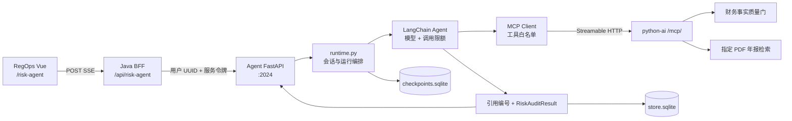

# 金融风险审计助手

金融风险审计助手是 RegOps Copilot 的 Agent 服务，面向上市公司公开财报执行**风险线索初筛**。它帮助分析人员更快找到值得核查的指标、原文和证据缺口，不出具正式审计意见、授信结论或投资建议。

前端已经集成到 RegOps：<http://localhost:5173/risk-agent>。本目录不再维护独立 Web UI，也不需要安装成 Python package，直接从源码启动 `agent.app:app`。

## 已实现能力

- 在页面选择具体 DeepSeek 或 Qwen 模型，而不是只选择供应商。
- Agent 在调用预算内自主决定查询哪些财务指标、检索哪些年报叙述。
- 通过 FastMCP 只访问 `lookup_financial_facts`、`search_report_evidence` 两个金融只读工具。
- F10 财务事实使用质量门状态和 SHA-256 来源校验；PDF 年报证据必须包含真实页码。
- 工具证据统一分配 `citation_id`，回答中的 `[1]`、`[2]` 可以跳转到事实库或年报原页。
- 同一次模型输出同时生成用户可读 Markdown 和机器可读 `RiskAuditResult`。
- Pydantic 校验结构、状态、严重程度和必填字段，并拒绝不存在的证据编号。
- `RiskFinding` 保存严重程度、结论、数据点、不确定性、人工核查问题和审核状态。
- POST SSE 实时返回执行阶段和最终回答；checkpoint 支持多轮会话及刷新恢复。
- 会话按 RegOps 登录用户隔离，MCP 不可用时在执行前失败关闭。

## 业务边界

金融模式不允许：

- 执行本机命令、修改文件或操作 Git/Gitee。
- 直接访问数据库或绕过 MCP 工具合同。
- 使用模型记忆、网页摘要或未验证数据补造财务数值。
- 把 `missing`、`unverified`、`conflict`、`missing_provenance`、`insufficient_evidence`、`unavailable` 当成可靠事实。
- 将候选原文直接表述为审计认定。

仓库里仍保留通用 DeepAgents Harness 的编程、审查和 Skills 代码，供学习 Harness 架构；RegOps `/risk-agent` 接口会强制进入 `financial_audit`，这些代码工具不会装配到金融 Agent。

## 架构



完整系统图和请求时序见 [`../docs/ARCHITECTURE.md`](../docs/ARCHITECTURE.md)。

## 一次请求如何执行

1. Vue 把问题和 `model_id` 发送到 Java BFF。
2. Java 从登录上下文提取用户 UUID，将 POST SSE 转发到 Agent。
3. Agent 在创建或继续会话前发现 MCP 工具；缺少任一白名单工具就返回 `503`。
4. `runtime.py` 创建 run，`server.py` 只为金融模式装配模型、两个 MCP 工具、checkpoint 和调用限额。
5. 模型自主调用工具；`ToolCitationIndexer` 给真实工具证据分配连续编号。
6. 模型输出 Markdown 和末尾的 `risk_audit_result` JSON。
7. `risk_result.py` 使用 Pydantic 校验 JSON，并确认每个 `evidence_id` 都来自本轮工具结果。
8. checkpoint 保存完整对话；业务 Store 保存 run、结构化结果和 findings。
9. API 通过 SSE 返回干净 Markdown、引用和结构化结果；机器 JSON 不展示给用户。

## 目录

```text
financial-risk-audit-assistant/
├── agent/
│   ├── app.py                         FastAPI 入口
│   ├── api/
│   │   ├── health.py                  健康检查
│   │   └── risk_agent.py              鉴权、会话、历史、POST SSE
│   ├── mcp/financial_client.py         MCP 工具发现、白名单和同步适配
│   ├── financial/
│   │   ├── citations.py               citation_id 分配与前端 Citation
│   │   └── risk_result.py              RiskFinding / RiskAuditResult 契约
│   ├── core/
│   │   ├── runtime.py                 任务、run、最终结果编排
│   │   ├── streaming_runtime.py       LangGraph V3 事件流适配
│   │   ├── checkpoint_history.py      历史恢复与机器 JSON 隐藏
│   │   ├── graph.py · persistence.py  SQLite checkpoint / Store
│   │   └── model.py                   模型目录与 LangChain 初始化
│   ├── store/sqlite_store.py          运行记录和结构化风险结果
│   ├── prompt.py                      金融边界与结构化输出规则
│   ├── server.py                      金融 Agent / 通用 Harness 装配
│   └── skills/                        金融初筛及保留的工程 Skills
├── data/                               本地 SQLite，Git 忽略
├── logs/                               Agent 日志，Git 忽略
├── scripts/                            启动、同步 Skills 和验证脚本
├── requirements.txt
└── Dockerfile
```

## 数据存储

| 文件 / 表 | 内容 |
| --- | --- |
| `data/checkpoints.sqlite` | LangGraph messages、工具调用和图状态；历史正文的权威来源 |
| `data/store.sqlite` / `threads`、`runs` | 会话摘要和每次运行状态 |
| `data/store.sqlite` / `risk_audit_results` | 公司、年份、状态、摘要、证据缺口和报告哈希 |
| `data/store.sqlite` / `risk_audit_findings` | 逐条风险线索及 `pending_review` 状态 |
| `data/langgraph_store.sqlite` | 通用 Harness 的 StoreBackend；金融事实不从这里读取 |

刷新页面时，聊天正文从 checkpoint 恢复，结构化结果按回答哈希关联回对应消息。删除会话时，两套 SQLite 数据会一起清理。

## 配置

服务优先读取 RegOps 根目录 `.env`，子项目 `.env` 可覆盖。至少需要：

```dotenv
REGOPS_SERVICE_TOKEN=change-me
REGOPS_MCP_URL=http://127.0.0.1:8000/mcp/
DEEPSEEK_API_KEY=
QWEN_API_KEY=
MAIN_MODEL=deepseek-v4-pro
```

- `REGOPS_SERVICE_TOKEN` 必须与 Java BFF、`python-ai` 一致，不能提交到 Git。
- Compose 中 MCP 地址使用 `http://python-ai:8000/mcp/`。
- 模型列表只返回已经配置对应 API Key 的具体型号。
- `CHECKPOINT_DB_PATH`、`STORE_DB_PATH`、`LANGGRAPH_STORE_DB_PATH` 可覆盖默认 SQLite 路径。

完整示例见根目录 [`.env.example`](../.env.example)。

## 启动

推荐从 RegOps 根目录统一启动：

```bash
./scripts/dev.sh up
./scripts/dev.sh status
```

只启动 Agent：

```bash
cd financial-risk-audit-assistant
python3.14 -m venv .venv
./.venv/bin/python -m pip install -r requirements.txt
./.venv/bin/python scripts/sync_skills.py
cd ..
./scripts/dev.sh up agent
```

修改 Agent Python 代码后执行：

```bash
./scripts/dev.sh restart agent
```

健康检查：<http://127.0.0.1:2024/health>。真实金融工具还要求 `python-ai` 在 `:8000` 运行并已准备 PostgreSQL 数据。

## 验证

以下命令不调用真实模型：

```bash
financial-risk-audit-assistant/.venv/bin/python financial-risk-audit-assistant/scripts/verify_risk_audit_result.py
financial-risk-audit-assistant/.venv/bin/python financial-risk-audit-assistant/scripts/verify_risk_agent_messages.py
financial-risk-audit-assistant/.venv/bin/python financial-risk-audit-assistant/scripts/verify_financial_audit.py
financial-risk-audit-assistant/.venv/bin/python financial-risk-audit-assistant/scripts/verify_backend.py
cd web && npm test && npm run build
```

## 当前下一步

1. 建立 20～30 条金融风险黄金评测集。
2. 增加结构化 finding 的人工接受、驳回和修改接口及页面。
3. 对比不同模型的召回率、误报率、引用正确率、耗时和成本。
